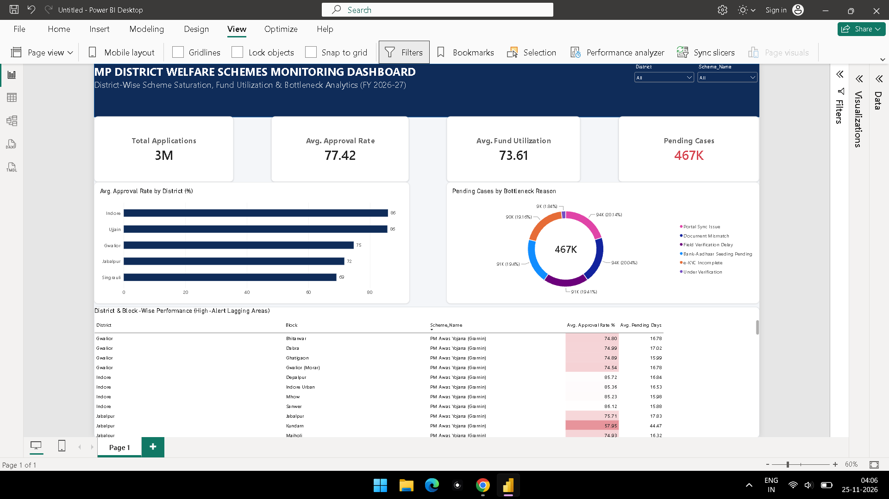

# MP District Welfare Schemes Monitoring Dashboard

An interactive **Power BI** dashboard that monitors welfare scheme performance across Madhya Pradesh districts and blocks (FY 2026-27): scheme saturation, fund utilization, approval rates and pending-case bottlenecks.



## Problem Statement

District administrations run several welfare schemes (MGNREGA, PM Awas Yojana (Gramin), Ladli Behna Yojana, MP Post-Matric Scholarship, etc.). Decision makers need one view to answer:

- Which districts and blocks are lagging in approvals?
- How much of the allocated fund is actually being utilized?
- What is blocking applications, and where are cases pending the longest?

## Key KPIs

| KPI | Value (current view) |
|---|---|
| Total Applications | ~3M |
| Avg. Approval Rate | 77.42 |
| Avg. Fund Utilization | 73.61 |
| Pending Cases | ~467K |

## Dashboard Components

- **KPI cards**: Total Applications, Avg. Approval Rate, Avg. Fund Utilization, Pending Cases
- **Bar chart**: Avg. Approval Rate by District
- **Donut chart**: Pending Cases by Bottleneck Reason
- **Table**: District & Block-wise performance with conditional formatting on approval rate (high-alert lagging areas)
- **Slicers**: District, Scheme_Name

## Key Insights

- **Indore and Ujjain** lead on approval rate (~86), while **Singrauli (~69)** is the lowest of the top-5 districts shown.
- **Singrauli (Chitrangi block)** and **Jabalpur (Kundam block)** are the most critical lagging areas: approval rates around 57% and average pending time of 44-46 days across schemes.
- Pending cases are spread almost evenly across six bottleneck reasons (each roughly 19-20%, with "Under Verification" as a small share), so the fix is process-wide (e-KYC, document verification, portal sync, Aadhaar seeding) rather than one single cause.

## Tech Stack

- Power BI Desktop (data modeling, DAX, visuals)
- DAX for measures
- Python (pandas) for synthetic data generation and cleaning
- CSV as the data source

## Repository Structure

```
mp-district-welfare-schemes-dashboard/
├── README.md
├── .gitignore
├── MP_District_Welfare_Dashboard.pbix
├── MP_District_Welfare_Dashboard.pdf
├── data/
│   ├── raw/mp_district_schemes_raw.csv
│   └── processed/mp_district_schemes_clean.csv
├── scripts/
│   ├── generate_data.py
│   └── clean_data.py
├── images/
│   └── dashboard.png
├── dax/
│   └── measures.dax
└── docs/
    └── data_dictionary.md
```

## How to Use

1. Clone the repository:
   ```bash
   git clone https://github.com/Deepak396347/mp-district-welfare-schemes-dashboard.git
   ```
2. Open `MP_District_Welfare_Dashboard.pbix` in **Power BI Desktop**.
3. If prompted, update the data source path: *Home → Transform data → Data source settings* and point it to `data/processed/mp_district_schemes_clean.csv`.
4. Use the District and Scheme_Name slicers to explore.

## Data

See [`docs/data_dictionary.md`](docs/data_dictionary.md) for column descriptions.

> **Note:** The dataset is **synthetic**, generated with Python (`scripts/generate_data.py`) and cleaned with `scripts/clean_data.py`. It was created for portfolio purposes and does not represent real government data.

### Data Pipeline

```
generate_data.py  →  mp_district_schemes_raw.csv  →  clean_data.py  →  mp_district_schemes_clean.csv  →  Power BI
```

Run it yourself:

```bash
python scripts/generate_data.py
python scripts/clean_data.py
```

## DAX Measures

All measures are listed in [`dax/measures.dax`](dax/measures.dax).

## Author

**Deepak Pandey**
Data Analytics and AI/ML fresher | MCA, APSU Rewa

- LinkedIn: [deepak-pandey-800188220](https://linkedin.com/in/deepak-pandey-800188220)
- GitHub: [Deepak396347](https://github.com/Deepak396347)
- Email: pandeydeepak77039@gmail.com
